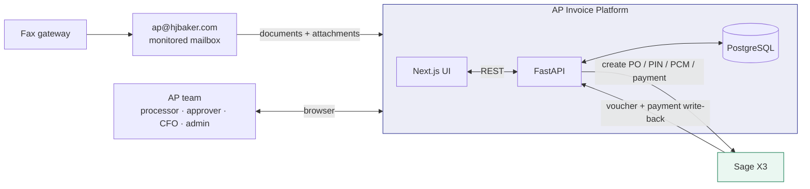
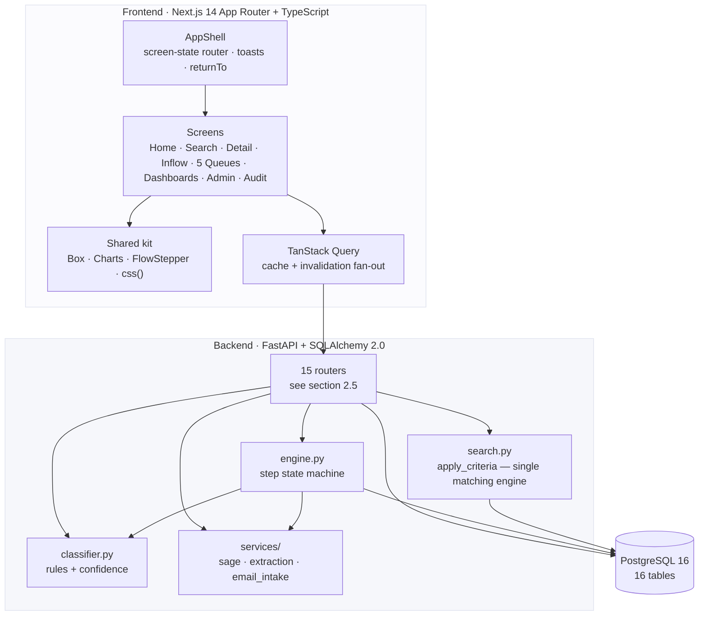
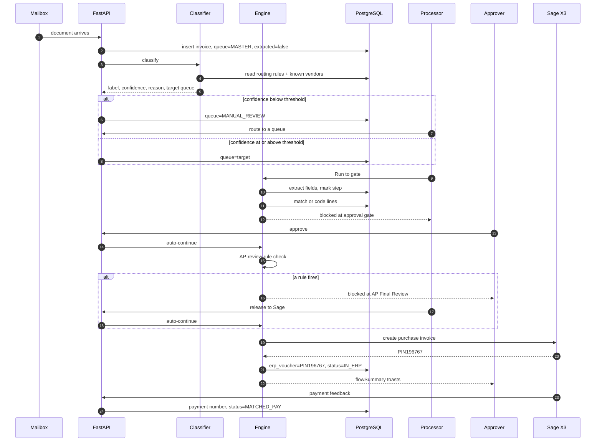
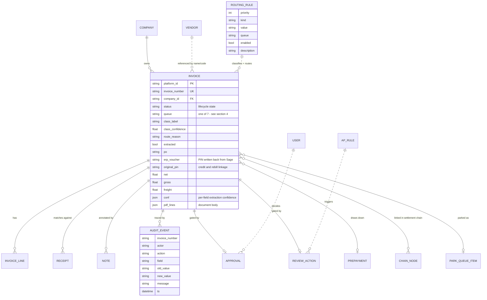
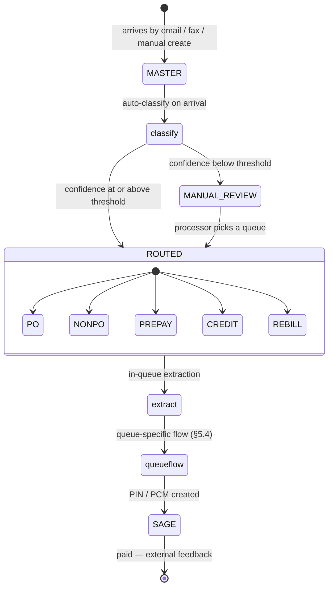
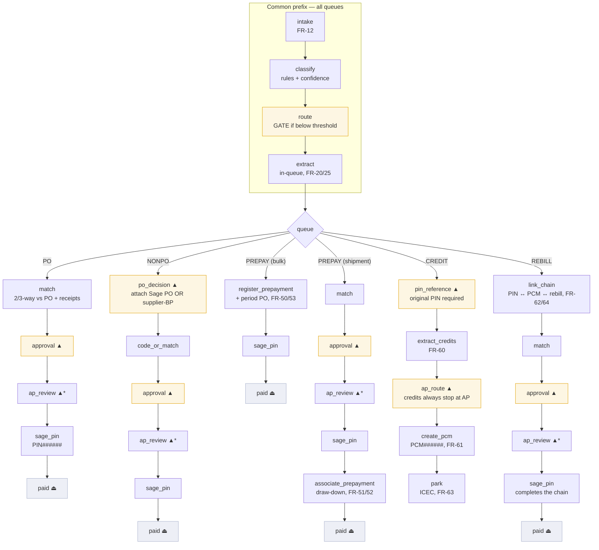

> **Superseded as the client-facing PRD.** The authoritative product requirements are now
> `docs/PRD.html` (v1.0), which carries the per-document-type process steps, the typed edge
> case registers and the architecture. This file is retained as the *engineering annex*:
> implementation-level detail, API surface, state model and verification harnesses.

# AP Invoice Processing Platform — Product Requirements Document

**Client:** H.J. Baker & Bro., LLC · **Built by:** Alferix
**Replaces:** Blue Creek / Vision360 · **ERP of record:** Sage X3
**Status:** implemented and verified against this document
**Companion doc:** [sage-integration.md](sage-integration.md) — the file-level Sage ↔ Blue Creek exchange contract

> This PRD documents the platform **as built**. Every rule, threshold, and edge case
> below is implemented in code and covered by an automated check (§11). Where the
> implementation deliberately diverges from the original requirement set, it is
> called out in §10.

---

## 1. Purpose & scope

### 1.1 Problem

AP at H.J. Baker receives vendor invoices into a shared mailbox and processes them
into Sage X3 through Blue Creek. The incumbent tool forces **100% human review**,
cannot express the different handling that PO, non-PO, prepayment, credit and rebill
documents require, and gives no visibility into where a document is or why.

### 1.2 What this platform does

1. **Receives** every document into one master inflow queue.
2. **Classifies** it against configurable routing rules, producing a label, a
   confidence score, and an explanation.
3. **Routes** it to one of five processing queues — or holds it in **Manual Review**
   when confidence is below threshold.
4. **Extracts** field data inside the queue.
5. **Runs the queue's own flow**, stopping only at genuine human decision points.
6. **Creates the Sage document** (PIN / PCM / payment) and **writes the number back**
   so the platform reflects ERP truth.

### 1.3 Out of scope (stubbed behind typed interfaces)

| Area | Current state | Seam |
|---|---|---|
| Sage X3 connectivity | `MockSageClient` returns realistic documents/numbers | `services/sage.py` — `SageClient` protocol |
| AI/OCR extraction | seeded per-field values + confidences | `services/extraction.py` |
| Mailbox ingestion | seeded arrivals + original-email records | `services/email_intake.py` |
| SSO (Entra ID) | current user read from `X-User` header | `routers/_common.py::current_user` |

### 1.4 Users

| Persona | Example | Does |
|---|---|---|
| Processor / Coder | Irene Castillo ($10k) | codes, attaches POs, resolves manual review |
| Approver | Kevin Weiland ($50k) | approves; over-limit escalates |
| CFO | Alicia Grant (unlimited) | escalation endpoint, email approvals |
| AP Reviewer | Nita Brandon | works the rule-flagged AP Final Review gate |
| Admin | Symantha Schaeffer ($0 enforced) | routing rules, lists, companies, users |
| Auditor | read-only | full traceability chain |

---

## 2. Architecture

### 2.1 System context



### 2.2 Layers & responsibilities

The hard rule: **the backend owns business logic and domain data; the frontend owns
presentation only.** No count, filter, or state decision is computed in the browser.



**Why one matching engine matters.** `search.apply_criteria` is the *only* code that
decides whether an invoice matches criteria. Dashboards, queues, home cards and the
search grid all count through it, which is what makes the click-through contract
(§6.2) structurally true rather than coincidental.

### 2.3 End-to-end interaction — arrival to paid



### 2.4 Runtime topology (current deployment)

| Process | Command | Port | Notes |
|---|---|---|---|
| PostgreSQL 16.6 | portable install in `%LOCALAPPDATA%\ap-invoice-pg` | 5432 | db `apinvoice`, tests use `apinvoice_test` |
| FastAPI | `uvicorn app.main:app --host 127.0.0.1 --port 8000` | 8000 | **never** `--reload` (OneDrive watcher squats the port) |
| Next.js | `npm run dev` | 3000 | never run `next build` while dev is live (clobbers `.next`) |

### 2.5 API surface

| Router | Prefix | Purpose |
|---|---|---|
| inflow | `/inflow` | intake log, original email, classify, manual route |
| queues | `/queues-v2` | 5 queue totals; per-queue sub-queues + rows |
| engine | `/engine` | flow read, step/run, gate resolution endpoints |
| invoices | `/invoices` | detail, field patch, create, notes, vendor refresh |
| search | `/search` | criteria search + Excel export |
| dashboards | `/dashboards` | overview variants, matrix, KPIs, analytics |
| approvals | `/approvals` | approval list + action + email action |
| ap_review | `/ap-review` | AP final review list + release/send-back |
| prepayments | `/prepayments` | positions + register |
| credits | `/credits` | settlement chain + park queues |
| matching | `/matching` | receipt matching, variance, import |
| admin | `/admin` | routing rules, companies, lists, users, AP rules |
| reports | `/reports` | export catalog with live row counts |
| home | `/home` | pipeline, work cards, alerts, recent activity |
| audit | `/audit` | immutable event log |

---

## 3. Data model



**16 tables**, 191 mapped columns. The `Invoice` table carries the full §5.4 field
dictionary from the original spec so the record is a faithful superset of Blue Creek's.

### 3.1 Canonical state

There is exactly one source of truth for "where is this document":

| Concern | Stored in | Notes |
|---|---|---|
| Lifecycle state | `Invoice.status` | UNPROCESSED, DATA_REQUIRED, AUTOMATCH, AP_REVIEW, IN_ERP, MATCHED_PAY, PAID, ERROR, PARKED_ICEC, PARKED_LEG, CANCELLED |
| Routing state | `Invoice.queue` | 7 values incl. the two holding queues |
| Sub-step progress | `AuditEvent` rows with `action="flow_step"` | steps that have no status column of their own |
| ERP truth | `Invoice.erp_voucher`, `payment_*` | written back from Sage, read-only in the UI |

**Invariant:** the engine never stores a duplicate "current step" field. Flow position
is *derived* from status + markers on every read, so the stepper cannot drift from
reality.

---

## 4. Document inflow pipeline



### 4.1 Intake requirements

| ID | Requirement | Implementation |
|---|---|---|
| FR-10 | Accept multi-page PDFs (~100 pages) | `pages_n`; 12-page load list in fixtures |
| FR-12 | Duplicate detection on **vendor + invoice number + amount** before create | `routers/invoices.py::create_invoice` → 409 |
| — | Every arrival is classified on arrival, not on a separate click | `seed._arrive_samples`, `create_invoice` |
| — | The **Incoming** view is the full intake log (every document ever received) | `GET /inflow` returns all rows |
| — | Each document retains its **original email** (from/to/received/subject/body/attachment) | `GET /inflow/email/{inv}` |

---

## 5. Classification, routing & the processing engine

### 5.1 Routing rules

Rules live in `routing_rules` (editable in **List Administration › Routing Rules**) and
are evaluated **in priority order, first hit wins**.

| Priority | Kind | Value (seeded) | Routes to | Base confidence |
|---|---|---|---|---|
| 10 | `vendor_prepaid` | Deer Park Refining | PREPAY | 0.95 |
| 11 | `vendor_prepaid` | CarMax | PREPAY | 0.95 |
| 20 | `negative_total` | — | CREDIT | 0.94 |
| 30 | `vendor_netback` | Chevron Products | REBILL | 0.92 |
| 31 | `vendor_netback` | SolTran | REBILL | 0.92 |
| 40 | `has_po` | prefix `P` | PO | 0.97 |
| 90 | `fallback` | — | NONPO | 0.91 |
| 999 | `threshold` | `0.80` | — | (gate value) |

**Exact trigger conditions** — a rule only fires when *all* of its conditions hold:

| Kind | Fires when |
|---|---|
| `vendor_prepaid` | `vendor_name` equals the rule value exactly |
| `negative_total` | `gross < 0` **OR** the document text contains `cancellation` / `credit memo` / `credit note` |
| `vendor_netback` | `vendor_name` equals the rule value **AND** `gross > 0` **AND** text contains `re-invoice` / `rebill` / `settled price` / `true-up` |
| `has_po` | `po != "—"` **AND** `po` matches `^P\d{2}-\d{4,6}$` |
| `fallback` | always (terminal rule) |

The netback rule requires a **positive** total precisely so a Chevron *cancellation*
(negative) is caught by the earlier credit rule and a Chevron *re-invoice* (positive)
reaches the rebill rule — see **EC-17**.

**Confidence formula**

```
confidence = base_confidence(rule_kind)
           - 0.35   if the vendor name is not in the known-vendor set
confidence = max(0.05, round(confidence, 2))
```

Known vendors = the `vendors` table ∪ vendor names on already-extracted invoices.
The penalty is what makes OCR noise fall out of the automated path: an otherwise
confident `has_po` hit (0.97) lands at 0.62 when the vendor is unreadable.

**Signal source is deliberately narrow.** `classifier._doc_text` reads **only**
`invoice_number` + `pdf_lines` — immutable document content. It must never read
`last_msg`, which the engine writes: see edge case **EC-02**.

### 5.2 Routing decision

| Condition | Result |
|---|---|
| `confidence >= threshold` | `queue = rule.queue`, `route_reason = rule explanation` |
| `confidence < threshold` | `queue = MANUAL_REVIEW`, reason appends `confidence N% < threshold M%` |
| No rules configured at all | conservative default → NONPO at fallback confidence |

Changing the threshold and re-classifying **re-routes** the document (verified: 0.95
sends CBRE's 0.91 to Manual Review; 0.80 sends it back to Non-PO).

### 5.3 Engine model

The engine is a **data-driven step machine**. A step is a dict:

| Key | Meaning |
|---|---|
| `key`, `label`, `fr` | identity + requirement reference |
| `gate` / `dynamic_gate` | is this a human decision point (dynamic = only when a rule fires) |
| `done(db, inv, marks)` | predicate deciding whether the step is already satisfied |
| `exec(db, inv, user)` | the state transition (auto steps only) |
| `blocked(db, inv)` | who we're waiting on + what they must do |
| `external` | advanced by an outside system, never auto-run |
| `unreachable` | shown for context but skipped by `run()` |

`run(db, inv, user, max_steps)` walks steps in order, executing the first not-`done`
step until it hits a gate or an external step.

**Every flow shares a 4-step prefix:** `intake → classify → route → extract`.

### 5.4 Per-queue flows



`▲` human gate · `▲*` **dynamic** gate (only when an AP-review rule fires) · `⏏` external

**Bulk vs shipment prepayment** is decided by `_is_bulk_prepayment`: the document must
*say* prepayment (`"prepay"` in the invoice number, or `"prepayment"` in the body).
**Amount is explicitly not a signal** — see **EC-03**.

#### Step reference

| Step | Auto/Gate | What it does | Satisfied when (`done`) |
|---|---|---|---|
| `intake` | auto | records arrival, duplicate check | always after insert |
| `classify` | auto | applies rules, sets label/confidence/reason | `class_confidence` is set |
| `route` | **gate** if below threshold | assigns the processing queue | `queue` is one of the 5 |
| `extract` | auto | reveals header fields + lines with per-field confidence | `extracted = true` |
| `match` | auto | 2-way (PO) or 3-way (PO + receipts) match | status ≥ AUTOMATCH |
| `po_decision` | **gate** | attach a Sage PO or elect supplier-BP | PO attached, marker set, **or** already coded/paid (EC-04) |
| `code_or_match` | auto | 2-way to the attached PO, or template coding | marker set or status ≥ AUTOMATCH |
| `approval` | **gate** | routes to the approver; over-limit escalates | approval row decided |
| `ap_review` | **dynamic gate** | only when a rule fires; otherwise auto-skipped | released, or no rule hit |
| `sage_pin` | auto | creates the purchase invoice in Sage | `erp_voucher != "—"` |
| `associate_prepayment` | auto | draws the PIN against the open prepayment | marker set |
| `pin_reference` | **gate** | captures the original PIN a credit reverses | `original_pin` set, **or** PCM already created (EC-04) |
| `extract_credits` | auto | pulls credited invoice numbers, splits per vendor | marker set |
| `ap_route` | **gate** | credits always stop at AP before the PCM | review released |
| `create_pcm` | auto | creates the credit memo tied to the original PIN | marker set |
| `link_chain` | auto | links original PIN ↔ PCM ↔ rebill | marker set |
| `park` | auto | parks in ICEC awaiting the true-up | status is a parked status |
| `paid` | **external** | payment feedback from Sage | status is a paid status |

### 5.5 Human gates

| Gate | Fires when | Resolved by | Endpoint |
|---|---|---|---|
| `route` | classification below threshold | processor picks a queue in Inflow | `POST /inflow/route/{inv}` |
| `po_decision` | Non-PO document, no PO attached | attach a Sage PO **or** elect supplier-BP | `POST /engine/attach-po/{inv}` · `POST /engine/no-po/{inv}` |
| `pin_reference` | credit memo without `original_pin` | enter the original PIN | `POST /engine/set-original-pin/{inv}` |
| `approval` | every invoice before Sage (FR-40) | approve / approve-&-escalate / reject | `POST /approvals/{inv}/action` |
| `ap_review` / `ap_route` | an AP rule fires (see below); credits always | release to Sage / send back | `POST /ap-review/{inv}/action` |

**Gates are the work queues.** Each gate is worked *inside the document's own
processing queue* — the `Awaiting Approval` and `AP Review` sub-queues render the
action cards, and the stepper deep-links straight to them.

**Auto-continue.** Approving or releasing runs `engine.run(..., max_steps=99)`, so a
single approval can carry a document through AP review → PIN → In ERP without another
click. The continuation is reported back as `flowSummary` and surfaced as toasts.

### 5.6 AP Final Review rules (FR-44)

Exception-only: most documents skip this gate entirely.

| Rule key | Fires when | Message |
|---|---|---|
| `errors` | `error_code != "—"` **or** terms confidence < 90 | "Terms mismatch" / the error code |
| `over25k` | `gross > 25,000` | "Over $25,000" |
| `flagged`, `newVendor` | *not modeled* — needs the flagged-vendor list | — |
| (credit memos) | always, regardless of rules | "Credit memo" |

### 5.7 Sage document numbering & write-back

Formats match the client's real documents (sourced from Symantha's sample exports):

| Document | Format | Example | Generation |
|---|---|---|---|
| Purchase order | `P{YY}-{seq}` | `P26-005942` | **manual in Sage**, attached here (§10) |
| Purchase invoice (voucher) | `PIN{6}` | `PIN196767` | `sage_pin` step, seq from max existing |
| Credit memo | `PCM{6}` | `PCM004410` | `create_pcm`, tied to `original_pin` |
| Payment | `PAY{AC|WT|CK}{6}` | `PAYWT023114` | method-prefixed, external feedback |

**Write-back requirement:** the PIN Sage returns is stored on `Invoice.erp_voucher` and
displayed as a first-class **PIN (Sage)** column on every queue row plus the ERP block
on Invoice Detail. This is the "it should reflect back in our tool" requirement.

---

## 6. Cross-cutting logic

### 6.1 Search semantics

36 header fields + 8 line fields + note and receipt fields, across four criteria tabs,
all **AND-ed**.

| Operator | Meaning |
|---|---|
| `=` | **exact match** (not contains) |
| `<>` | not equal |
| `>` `<` `>=` `<=` | numeric comparison |
| `BETWEEN a..b` | inclusive numeric range |
| `LIKE` | contains, or wildcard pattern if `%` present |
| `%text` / `text%` / `%text%` | ends / begins / contains |
| `a,b,c` on an exact field | **IN-list** |

**Virtual fields** (not invoice columns — computed from workflow state):

| Field | True when |
|---|---|
| `awaitingApproval` | an undecided `Approval` row exists |
| `awaitingApReview` | an undecided `ReviewAction` row exists |
| `sentLast24` | status is a sent status and `last_date` is within 24h |
| `queueV2` | the document's processing queue |

### 6.2 The click-through contract

> **Every number the platform displays must equal the number of rows you get when you
> click it.**

Mechanically enforced: each clickable count ships the exact `filters` (values **and**
per-field `ops`) that produced it, the UI loads those criteria verbatim into the search
form, and the count is computed through the same `apply_criteria` the search uses.

Covered surfaces: home pipeline (8 stages), home work cards, 5 queues × 9 sub-queues,
overview matrix, 6 dashboard panel variants. **405 automated assertions** (§11).

Hidden virtual criteria (e.g. `awaitingApproval`) are surfaced as removable amber
chips in the filter form, so a filter can never silently return zero.

### 6.3 Authorization & approvals

| Rule | Value |
|---|---|
| Approver limit | $50,000 (Kevin Weiland) |
| Over-limit behaviour | escalates to Alicia Grant (CFO); button reads "Approve & escalate" |
| Admin limit | $0, enforced |
| Reject | **requires a comment** (400 without one) |
| Segregation of duties | no user may approve an invoice they created or edited past extraction |
| Email approval (FR-43) | signed token, 72h expiry, every action logged |

### 6.4 Audit trail (FR-46, FR-83, NFR-4)

Immutable, append-only `audit_events`. Every field edit (old → new), classification,
routing decision, gate resolution, engine step, and Sage write is recorded with actor
and timestamp. Actions seen in a clean run: `inflow`, `classified`, `manual_route`,
`flow_step`, `field_edit`, `approval_approved`, `approval_rejected`, `review_released`,
`review_sentback`, `po_attached`, `pin_referenced`, `create`, `note`,
`routing_rule_*`, `company_*`.

---

## 7. Edge cases

Each row is a real failure mode that was found and fixed, with the guard that now
prevents regression.

### 7.1 Engine & state

| ID | Edge case | Behaviour / guard |
|---|---|---|
| EC-01 | Session `autoflush=False` hid freshly written flow markers, so `run()` re-executed the same step forever (a prepayment reached 101 PINs) | `_mark()` calls `db.flush()` so markers are visible inside the transaction |
| EC-02 | Flow **kind flapped mid-run**: `_doc_text` included `last_msg`, which the engine itself rewrites, so a shipment invoice became a bulk prepayment after association and booked a spurious $412,885 top-up | classifier and engine read **only** `invoice_number` + `pdf_lines` |
| EC-03 | A $23.9M CarMax *shipment* true-up was misread as a bulk prepayment because detection used amount | bulk detection is **keyword-only**; amount is never a signal |
| EC-04 | Legacy documents already paid still showed a **blocked gate mid-flow** (`po_decision` blocked while later steps were done) | gate `done` predicates also accept downstream evidence (`code_or_match` marker, or status ≥ AUTOMATCH); same fix on `pin_reference` |
| EC-05 | External `paid` step could be auto-run by a full `run()` | `external: True` — `run()` stops before it; only an explicit single step advances it |
| EC-06 | Context-only steps would block the walker | `unreachable` steps are rendered but skipped |
| EC-07 | Re-running a completed flow | `run()` is idempotent — every `done` predicate is satisfied, nothing executes |
| EC-08 | `from .routers import engine` shadowed the SQLAlchemy `engine` object → `_run_ddl_visitor` crash on startup | imported as `engine_router` |

### 7.2 Classification & routing

| ID | Edge case | Behaviour / guard |
|---|---|---|
| EC-09 | Garbled OCR vendor ("Gu1f C0ast Mar1ne") | unknown-vendor penalty −0.35 drops it to 0.56 → Manual Review with reason "vendor not recognized" |
| EC-10 | Statement-of-account document (ambiguous vs invoice) | 0.62 → Manual Review |
| EC-11 | Handwritten fax ticket | 0.56 → Manual Review |
| EC-12 | Threshold raised above a document's confidence | re-classification re-routes it to Manual Review; lowering it routes it back |
| EC-13 | Routing to an unknown queue | 400 |
| EC-14 | Re-routing a document already in a processing queue | 409 with the current queue named |
| EC-15 | Deleting a structural rule (`threshold`, `fallback`, `has_po`, `negative_total`) | 409 — "disable it instead" |
| EC-16 | Threshold set outside `0 < t <= 1` | 400 |
| EC-17 | Negative-total document that is *also* from a netback vendor | priority order decides: `negative_total` (20) wins over `vendor_netback` (30) → Credits |

### 7.3 Purchase orders

| ID | Edge case | Behaviour / guard |
|---|---|---|
| EC-18 | PO in the wrong format | regex `^P\d{2}-\d{4,6}$` → 400 with the expected shape |
| EC-19 | Attaching a PO already on another invoice | 409 **naming the holding invoice** |
| EC-20 | Attaching the PO the invoice already has | 409 (self-conflict) |
| EC-21 | Supplier-BP invoice (rent, equipment — never has a PO) | `po` stays `—`; lines coded from template `SUPPLIER-BP`; flow proceeds |
| EC-22 | Late PO — invoice arrives before the PO exists | parks in the Non-PO **Awaiting PO** sub-queue until attached |

### 7.4 Prepayments

| ID | Edge case | Behaviour / guard |
|---|---|---|
| EC-23 | Second bulk prepayment for a vendor with an open position | **top-up**, not a duplicate: total increases and consumption % is recomputed |
| EC-24 | Consumption exceeds the prepaid amount | position turns red with "Exceeded by $X — review (FR-52)" |
| EC-25 | Consumption crosses 100% exactly | pct clamps at 100%, alert switches to Exceeded |
| EC-26 | Shipment invoice with no open prepayment | falls through to the standard match/approve flow |
| EC-27 | Period inference when the document has no explicit month | falls back to the invoice date's month/year |

### 7.5 Credits & rebills

| ID | Edge case | Behaviour / guard |
|---|---|---|
| EC-28 | Credit memo with no original PIN | `pin_reference` gate blocks; PCM cannot be created without it |
| EC-29 | Original PIN in the wrong format | `^PIN\d{6}$` → 400 |
| EC-30 | Multi-vendor credit memo (CM-1108) | credited invoices extracted, per-vendor totals split (FR-60) |
| EC-31 | Rebill targets a **closed period** | routed for AP decision (FR-64) rather than auto-posted |
| EC-32 | Chain shows "pending PIN" until the rebill posts | `sage_pin` backfills chain node 2 with the real PIN, completing PIN ↔ PCM ↔ rebill |
| EC-33 | Credit parks and must clear automatically | ICEC park item flips to "PCM created · awaiting rebill", clears on true-up (FR-62/63) |

### 7.6 Search, counts & dashboards

| ID | Edge case | Behaviour / guard |
|---|---|---|
| EC-34 | `=` behaved as *contains* — typing `1` in Platform ID returned every row | `=` is exact; partial matching requires `LIKE` or `%` |
| EC-35 | A multi-status stage showed 2 but clicked through to 1 | CSV values are IN-lists on exact fields; the select renders the combined value |
| EC-36 | Dashboard variants that mean "has a PO" invert if operators are dropped | cells carry `ops` as well as `values`; the UI passes both |
| EC-37 | Typed criteria lost when switching tabs; Clear didn't reset | filter state is fully controlled (`crit` / `critApplied`) and persists per session |
| EC-38 | A count derived from fixtures instead of the database | **all** counts are computed from the DB through `apply_criteria` |
| EC-39 | Postgres returned dropdown items in arbitrary order on `seq` ties | `order_by(ReferenceListItem.id)` |
| EC-40 | Home cards counted queue rows, not invoices, so a demo-only row inflated them | cards count invoices via subquery, matching their click-through |

### 7.7 Data integrity

| ID | Edge case | Behaviour / guard |
|---|---|---|
| EC-41 | Duplicate invoice submission | 409 on vendor + invoice number + amount (FR-12) |
| EC-42 | Deleting a company that still has invoices | blocked — shown as "in use" |
| EC-43 | Totals that don't reconcile | `net + taxes + freight == gross` checked; variance blocks submission and is surfaced |
| EC-44 | Receipt sets larger than the old 500-line cap | virtualized; a 1,012-receipt summary and 1,014-line load list both process (FR-33, NFR-1) |
| EC-45 | Non-Postgres database URL | app **refuses to start** — no SQLite fallback |

### 7.8 UI & accessibility

| ID | Edge case | Behaviour / guard |
|---|---|---|
| EC-46 | ~50 text/background pairs below WCAG AA (worst 1.64:1) — the "barely visible" text | all text tones recomputed hue-preserving to clear 4.5:1 on all eight surfaces; audited to **zero failures** across 14 screens |
| EC-47 | Light text darkened onto *dark* surfaces during the sweep | sidebar rail and PDF chrome use a light token verified against those surfaces |
| EC-48 | White initials on light avatar plates | plates darkened so white text clears 4.5:1 |
| EC-49 | Fixed-width page containers left large empty gutters on wide monitors | screen containers are fluid; grids reflow via `auto-fit` |
| EC-50 | Toast ids collided during bursts (one per document) | monotonic counter, not a timestamp |
| EC-51 | Async buttons gave no feedback; users double-clicked Export | `Box` renders pressed state + busy spinner; void-element safe |
| EC-52 | Deep-linking into a document lost the way back | `returnTo` records the originating screen for **‹ Back** |

---

## 8. Non-functional requirements

| ID | Requirement | Status |
|---|---|---|
| NFR-1 | No practical line limit on receipt/line grids | met — virtualized, 1,014-line document processes |
| NFR-3 | Signed, expiring tokens for email actions; all actions logged | met (mock token) |
| NFR-4 | Immutable audit trail | met — append-only |
| NFR-6 | ≥95% auto-extraction | tracked as a KPI (96.2% displayed) |
| NFR-7 | Idempotent Sage writes; retry safe on outage | met — `done` predicates make every step idempotent |
| — | WCAG 2.1 AA text contrast | met — measured, zero failures |
| — | PostgreSQL only, no silent fallback | met — DSN validated at startup |

---

## 9. Screen inventory

| Group | Screens |
|---|---|
| Home | pipeline · work cards · alerts · recent activity |
| Invoices | Search (Filter/Results) · Detail View (fields + full-page PDF + source linking + stepper) · Invoice Create |
| Dashboards | Overview (All) · Aging · ERP & Cancelled · Non-PO · PO Only · 405/410 · Reports · Invoice Dashboard · Analytics |
| Queues | Inflow (Classifier) · PO · Non-PO · Prepayments · Credits · Rebills — each with 9 lifecycle sub-queues |
| Administration | List Administration (9 tabs incl. Routing Rules) · User Administration · Audit Log |

Each processing queue contains: **All · Unprocessed · Data Required · Auto-Matched ·
Awaiting Approval · AP Review · Sent to ERP · Paid · Exceptions** (Non-PO adds
**Awaiting PO**). Approvals and AP Final Review are worked inside the queue.

---

## 10. Divergences from the original requirement set

### 10.1 FR-38 — auto-generate the next PO: **RETIRED**

The original spec had the platform fetch a vendor's last PO and create the next number
by incrementing. The 07/2026 client call established this **cannot be automated**:
POs are raised at manual order sites, IRT rail/truck lines are imported, and
quantity/price are keyed by hand.

**Replacement:** the Non-PO queue's `po_decision` gate. The processor creates the PO in
Sage and attaches its number (format- and uniqueness-validated), or elects the
supplier-BP path. The vendor's last Sage PO is shown as **reference text only**.

### 10.2 Deferred

| Item | Reason |
|---|---|
| `flagged` / `newVendor` AP-review rules | require a flagged-vendor list that isn't modeled yet |
| Auto-approval thresholds (FR-45) | feature-flagged **off** by design; enable per company once accuracy is proven |
| `/dashboards/overview-matrix` | endpoint retained but no longer used by any screen (Overview All reverted to panels) — candidate for removal |

---

## 11. Verification

| Layer | What it proves | Count |
|---|---|---|
| `pytest` (7 files) | unit + API behaviour: search semantics, engine flows per queue, inflow classification, gates, dashboards, home contracts | **78 tests** |
| Live invariant audit | click-through contract on every displayed count, classifier/threshold agreement, step ordering, gate integrity, Sage formats, totals, approval limits, duplicate/PO guards, audit coverage | **405 assertions** |
| Contrast audit | WCAG AA on every text node, alpha-composited, across all screens | **14 screens, 0 failures** |
| Functional sweep | every screen's controls incl. write paths (approve → PIN → queue row), admin CRUD round-trips, chart table views | **60+ cases** |
| `tsc --noEmit` | frontend type safety | clean |

**Reset to a pristine demo state:** drop and recreate the `apinvoice` database, then
restart the backend — it reseeds 46 documents (38 processed history + 8 arrivals, 3 of
them held in Manual Review).

---

## 12. Open questions for the client

1. **Exact AP Final Review rule set** — owner: Symantha with the AP team. Two rules are
   implemented; the flagged-vendor and new-vendor rules need the list defined.
2. **Flagged-vendor list** — which vendors, and for how many invoices?
3. **Auto-approval thresholds** — amount and confidence floor per company, and which
   company goes first.
4. **Prepaid vendor list** — currently two (Deer Park, CarMax). Confirm the full set.
5. **Netback vendor list and cadences** — Chevron and SolTran are seeded; confirm the
   rest and their settlement timing.
6. **Closed-period policy** for rebills — who decides, and what is the cut-off?

---

## 13. Glossary

| Term | Meaning |
|---|---|
| **PIN** | Sage X3 purchase invoice (voucher) number |
| **PCM** | Sage X3 credit memo number |
| **Supplier BP** | A business-partner invoice that never has a PO (rent, equipment) |
| **Netback** | Provisional pricing settled later; reversed by credit and re-invoiced |
| **Rebill** | The settled-price re-invoice that follows a netback credit |
| **ICEC / LEG** | Parking queues holding documents awaiting a true-up |
| **Sub-queue** | A lifecycle bucket inside a processing queue |
| **Gate** | A step the engine cannot pass without a human decision |
| **Click-through contract** | Every displayed count equals its filtered result set |
